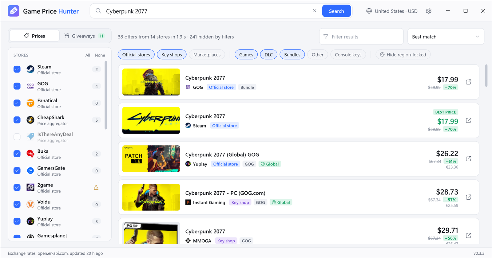
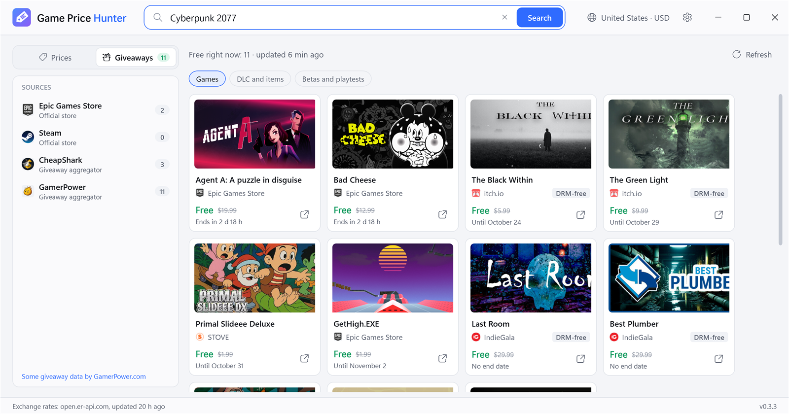

# Game Price Hunter

Find the cheapest price for any PC game, and see which games stores are giving away for free right now. Type a title, or just part of it, and you get prices from 25+ stores in one list, converted to your currency.

<picture>
  <source media="(prefers-color-scheme: dark)" srcset="docs/images/screenshot-dark.png">
  
</picture>

## Features

- **Official stores, key shops and marketplaces in one search:** Steam, GOG, Fanatical, Epic, Humble, Green Man Gaming, Instant Gaming, Eneba, K4G, Plati, GGSEL, Driffle and many more.
- **Free games right now** from Epic, Steam, IndieGala, itch.io and other stores, with the time left to claim them (see below).
- **Your region is detected automatically**, so you see local prices in your currency.
- **Region-locked keys are flagged**, and you can hide keys that won't activate in your country.
- **Seller rating and sales count** on Plati and GGSEL offers, so you can tell an established seller from a newcomer.
- **Filters** for DLC, bundles and console keys, plus sorting by price, discount or best match.
- **In your language:** English, Deutsch, Español, Français, Italiano, Polski, Português (Brasil), Türkçe, Русский, Українська, 简体中文, 日本語 and 한국어. Prices are written the way your country writes them.
- Dark and light themes.

## Free games

The **Giveaways** tab lists the games that Epic, Steam, IndieGala, itch.io and other stores are giving away right now, with the time left to claim each one, plus next week's free games on Epic. The welcome screen shows the first few, and when the game you search for is free now or soon, it shows up above the prices.

<picture>
  <source media="(prefers-color-scheme: dark)" srcset="docs/images/giveaways-dark.png">
  
</picture>

## Download

From the [latest release](../../releases/latest):

- **GamePriceHunter-Setup.exe** installs the app and keeps it up to date. No administrator rights needed.
- **GamePriceHunter.exe** is the portable version: just run it. It tells you when a new version is out.

Requires Windows 11 or Windows 10 version 1607 or later (64-bit).

## Good to know

- Marketplace offers come from independent sellers. Check the seller and the key region before buying.
- Keys from Russian stores are usually for Russia/CIS.
- Prices are taken from the stores' websites and may change. The store page always has the final price.
- Some giveaway data comes from [GamerPower](https://www.gamerpower.com/). Giveaways found by GamerPower and CheapShark aren't checked for your region.
